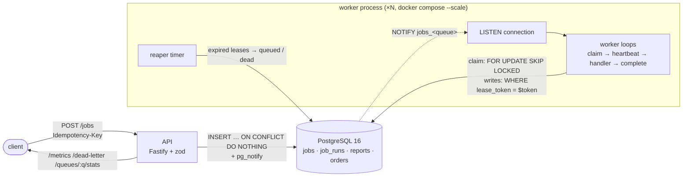
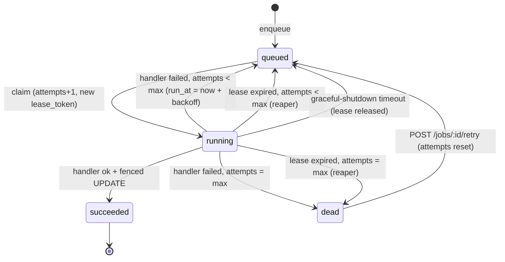

# TaskRelay

[](https://github.com/OWNER/taskrelay/actions/workflows/ci.yml)

A PostgreSQL-backed background job system (TypeScript, Node.js 22, PostgreSQL 16) built to show that its correctness claims hold, with tests and measurements for each one. Concurrent workers never run the same job at the same time. Crashed workers' jobs come back. A worker that lost its lease can't overwrite the new owner. Re-executions don't duplicate writes.

```
POST /jobs ──► jobs table ──► N workers: claim (SKIP LOCKED) ─► heartbeat ─► run handler ─► complete (fenced by lease_token)
                   ▲                                                                              │
                   └──────────── reaper: expired lease → queued / dead ◄─────────── crash ────────┘
```

## Architecture



### Job states



## Results

All numbers below were produced by the scripts in `bench/`. This section is generated from `bench/results/*.json` by `npm run bench:report`. Every results file records its environment: CPU, memory, PostgreSQL version and settings, and whether it ran in Docker.

<!-- results:start -->

### E1 — throughput vs workers (100,000 jobs)

**Batch size 1** (jobs claimed per claim query)

| workers | jobs/s | total s | exec p50 / p95 ms | DB CPU (cores) | client CPU (cores) | avg backends in top wait states | jobs/s, sync_commit=off |
| --- | --- | --- | --- | --- | --- | --- | --- |
| 1 | **283** | 353.15 | 2.04 / 4.1 | 0.34 | 0.15 | IO:WALSync 0.86, CPU 0.09 | 933 |
| 2 | **427** | 234.26 | 3.22 / 4.55 | 0.58 | 0.21 | IO:WALSync 0.9, LWLock:WALWrite 0.41 | 1,267 |
| 4 | **720** | 138.8 | 3.51 / 5.44 | 1.06 | 0.3 | LWLock:WALWrite 1.62, IO:WALSync 0.91 | 1,580 |
| 8 | **965** | 103.63 | 5.31 / 7.67 | 1.95 | 0.46 | LWLock:WALWrite 4.12, CPU 1.31 | 2,126 |
| 16 | **1,364** | 73.32 | 7.94 / 10.11 | 3.33 | 0.69 | LWLock:WALWrite 9.36, CPU 2.25 | 2,783 |
| 32 | **2,654** | 37.68 | 8.02 / 11.09 | 5.27 | 0.89 | LWLock:WALWrite 17.71, CPU 3.44 | — |
| 64 | **3,052** | 32.76 | 14.89 / 20.53 | 5.79 | 1.01 | LWLock:WALWrite 21.61, CPU 3.07 | — |

**Batch size 10** (jobs claimed per claim query)

| workers | jobs/s | total s | exec p50 / p95 ms | DB CPU (cores) | client CPU (cores) | avg backends in top wait states | jobs/s, sync_commit=off |
| --- | --- | --- | --- | --- | --- | --- | --- |
| 1 | **472** | 211.97 | 1.82 / 2.79 | 0.29 | 0.14 | IO:WALSync 0.82, CPU 0.11 | 1,753 |
| 2 | **570** | 175.48 | 3.14 / 4.48 | 0.47 | 0.19 | IO:WALSync 0.88, LWLock:WALWrite 0.43 | 2,373 |
| 4 | **1,065** | 93.88 | 3.34 / 4.87 | 0.88 | 0.28 | LWLock:WALWrite 1.79, IO:WALSync 0.95 | 2,771 |
| 8 | **1,430** | 69.92 | 4.97 / 7.41 | 1.65 | 0.44 | LWLock:WALWrite 4.42, CPU 1.05 | 3,918 |
| 16 | **2,008** | 49.8 | 7.28 / 9.72 | 2.8 | 0.67 | LWLock:WALWrite 9.93, CPU 1.64 | 4,234 |
| 32 | **3,784** | 26.43 | 7.77 / 10.02 | 4.59 | 0.89 | LWLock:WALWrite 19.14, CPU 2.28 | — |
| 64 | **3,865** | 25.87 | 14.54 / 24.64 | 5.88 | 1.03 | LWLock:WALWrite 23.61, CPU 3.34 | — |

_Source: `bench/results/e1_throughput_2026-11-17.json` + `bench/results/e1_throughput_wide_2026-11-17.json`. PostgreSQL 16.16 (Debian 16.16-1.pgdg13+1) in Docker (no CPU limit, synchronous_commit=on), 12 vCPU / 7.6 GB visible to containers, 13th Gen Intel(R) Core(TM) i7-1365U; Windows 11 host, Docker Desktop (WSL2 VM); client and PostgreSQL share the VM._

### E2 — claim strategies (10,000 jobs, 8 workers; median of 3 runs)

| strategy | jobs/s | duplicate executions (all runs) | jobs run >1× | claim p95 ms | avg backends waiting on locks | jobs/s, sync_commit=off |
| --- | --- | --- | --- | --- | --- | --- |
| `naive` | **263** | 20,728 (20,728 / 20,835 / 20,566) | 9,524 | 8.75 | 1.25 | 619 |
| `for_update` | **632** | 0 (0 / 0 / 0) | 0 | 17.3 | 3.57 | 3,511 |
| `skip_locked` | **1,061** | 0 (0 / 0 / 0) | 0 | 3.04 | 0 | 3,282 |

_Source: `bench/results/e2_claim_strategies_2026-11-17.json`. PostgreSQL 16.16 (Debian 16.16-1.pgdg13+1) in Docker (no CPU limit, synchronous_commit=on), 12 vCPU / 7.6 GB visible to containers, 13th Gen Intel(R) Core(TM) i7-1365U; Windows 11 host, Docker Desktop (WSL2 VM); client and PostgreSQL share the VM._

### E3 — wake-up latency at low load (enqueue → start, poll interval 1 s)

| workers | mode | jobs | p50 ms | p95 ms | p99 ms | max ms |
| --- | --- | --- | --- | --- | --- | --- |
| 1 | poll only | 278 | 463.7 | 957.4 | 994.7 | 997.4 |
| 1 | LISTEN/NOTIFY + poll | 308 | 4.2 | 7.2 | 8.9 | 23.6 |
| 4 | poll only | 322 | 446.7 | 932.9 | 973.2 | 1000 |
| 4 | LISTEN/NOTIFY + poll | 297 | 4 | 13.6 | 14.6 | 15.4 |

_Source: `bench/results/e3_wakeup_2026-11-17.json`. PostgreSQL 16.16 (Debian 16.16-1.pgdg13+1) in Docker (no CPU limit, synchronous_commit=on), 12 vCPU / 7.6 GB visible to containers, 13th Gen Intel(R) Core(TM) i7-1365U; Windows 11 host, Docker Desktop (WSL2 VM); client and PostgreSQL share the VM._

### E4 — chaos: SIGKILL random workers (10,000 report jobs, 8 worker containers)

| metric | value |
| --- | --- |
| run time | 154.4 s |
| workers killed (`docker kill -s KILL`) | 43 (39 while holding a job) |
| jobs succeeded / dead / stuck running | 10,000 / 0 / **0** |
| executions / distinct jobs | 10,040 / 10,000 |
| duplicate executions (at-least-once) | **40** (40 jobs) |
| `reports` rows / succeeded jobs | 10,000 / 10,000 |
| duplicate report rows | **0** |
| re-executions whose INSERT was absorbed by ON CONFLICT | 1 |
| succeeded jobs missing a report | 0 |

_Source: `bench/results/e4_chaos_2026-11-17.json`. 10000 report jobs (simulate_ms=100), 8 worker containers x 1 loop, lease 5000 ms, reaper every 1 s. Every 2-4 s a random running worker container is killed with `docker kill --signal KILL` and restarted 1 s later._

<!-- results:end -->

### What the numbers show

**E1: the bottleneck is commit latency (WAL flush). CPU and lock contention are not the limit.** Each job costs 4 commits: claim, run-log insert, report insert, complete.
- With 1 worker, PostgreSQL does exactly **3.99 WAL fsyncs per job**, and the backend spends 86% of its sampled time in `IO:WALSync`. Throughput is about 1 / (4 × fsync latency).
- Adding workers helps because of **group commit**: concurrent commits share one flush. Fsyncs per job fall from 3.99 (1 worker) to 1.17 (8), 0.38 (32) and 0.31 (64). The dominant wait shifts to `LWLock:WALWrite`, which means "queued behind the flush in progress". That is why 16→32 workers nearly doubles throughput while per-job latency stays flat (p50 7.9 → 8.0 ms).
- Batching the claim (batch 10) removes most of a commit per job: +67% at 1 worker (283 → 472).
- Turning `synchronous_commit` off for the benchmark connections (a diagnostic, not a recommendation) gives 3.3–3.7× at 1 worker. The WAL wait states disappear from `pg_stat_activity`, which confirms the cause.
- DB CPU never exceeds 5.9 of 12 cores, and `Lock:*` waits are ≈ 0 throughout. `pg_stat_statements` shows the claim statement averaging 0.45 ms of execution. The rest of each job's ~8 ms is waiting for commits.

**The knee is at about 32 workers.** With batch 10, 32 → 64 workers adds 2% throughput (3,784 → 3,865) while p95 execution time goes from 10 to 25 ms. With batch 1 the same step adds 15%, again with latency doubling. At 64 workers a second limit appears. All loops live in one Node.js process, which is pinned at 1.0 core, and backends spend time in `Client:ClientRead`, meaning they wait on the client. Going further needs more worker *processes* (`docker compose up --scale worker=N`) and fewer commits per job, not more loops.

**E2: `naive` is wrong, `for_update` is slow, `skip_locked` is both correct and fastest.**
- `naive` executed 10,000 jobs about 30,700 times: **~20,700 duplicate executions, and about 95% of jobs ran more than once**, consistently across 3 runs. It was also the slowest, because it does the extra work twice and its UPDATEs pile onto the same row. The lease-token fence rejected all ~20,700 losing completions (`stale_completion`), so job *state* stayed consistent. The *side effects* still ran about 3× each. Fencing alone does not fix a broken claim.
- `for_update` never duplicated, but on average 3.6 of 8 backends were blocked on a row lock. Claim p95 was 17 ms vs 3 ms, and throughput 40% lower (632 vs 1,061 jobs/s).
- **Unexpected:** with `synchronous_commit=off`, `for_update` and `skip_locked` are indistinguishable. Paired runs differed by −7%, +4% and +7%, within run-to-run noise, and lock waiters dropped to 0.4. The reason is that under `FOR UPDATE` a waiter is blocked for as long as the lock holder's transaction lasts. With durable commits that includes a WAL flush, and with async commit it lasts microseconds. So the advantage of `SKIP LOCKED` scales with the length of the claim transaction. It matters most exactly when commits are slow, or when the claim is part of a longer transaction.

**E3: NOTIFY cuts pickup latency by about 110×.** p50 drops from 464 ms to 4.2 ms. Polling gives p50 ≈ half the interval and p95 ≈ the interval. Four polling workers were no better than one, because the loops stay in phase: they start together and each sleeps a full interval after an empty claim. Jittering the poll interval would spread them out. With NOTIFY, polling only covers missed notifications and delayed `run_at`.

**E4: at-least-once happened, and idempotency held.**
- 43 SIGKILLs left 0 jobs stuck. Every job succeeded, and 40 jobs ran twice.
- `reports` has exactly one row per succeeded job. Note that "0 duplicate report rows" is guaranteed by the `UNIQUE (report_key)` constraint, so the meaningful checks are that rows equal succeeded jobs and that no succeeded job is missing its report.
- Only **1** re-execution actually collided with an earlier attempt's report. The simulated work sits *before* the write, so few kills landed in the narrow write→complete window. That window is covered deterministically by test 4, where fault injection crashes exactly there.

## Quick start

Requirements: Docker (with compose v2) and Node.js ≥ 22.12.

```bash
npm ci
npm run demo          # postgres + api + 4 workers, enqueue 1,000 report jobs via HTTP, print stats + /metrics
```

Or step by step:

```bash
docker compose up -d --build --scale worker=4      # postgres, api on :3000, 4 worker containers
curl -X POST localhost:3000/jobs -H 'content-type: application/json' -H 'Idempotency-Key: r-1-2025-01' \
     -d '{"type":"report","payload":{"tenant_id":1,"period":"2025-01"}}'
curl localhost:3000/jobs/<id>
curl localhost:3000/queues/default/stats
curl localhost:3000/dead-letter
curl -X POST localhost:3000/jobs/<id>/retry
curl localhost:3000/metrics
```

Tests run against a real PostgreSQL (database `taskrelay_test`, created by `docker/initdb.sql`):

```bash
npm run db:up && npm test        # or: npm run lint && npm run typecheck && npm test
```

| endpoint | purpose |
| --- | --- |
| `POST /jobs` | enqueue `{type, payload, queue?, priority?, max_attempts?, delay_ms?}`; optional `Idempotency-Key` header → `201` new / `200` existing |
| `GET /jobs/:id` | job state, attempts, last_error, lease |
| `GET /queues/:queue/stats` | counts per status, age of the oldest runnable job |
| `GET /dead-letter?queue=&limit=` | dead jobs with `last_error` and `attempts` |
| `POST /jobs/:id/retry` | dead → queued with a fresh attempt budget (`409` if not dead) |
| `GET /metrics` | Prometheus. API: queue depth per status (`status="dead"` = DLQ size). Each worker process also serves `:9100/metrics`: wait and execution time histograms, outcomes (succeeded / retried / dead), `stale_completion`, expired leases |
| `GET /health` | DB round-trip |

Worker settings (env): `WORKER_CONCURRENCY`, `WORKER_BATCH_SIZE`, `LEASE_MS` (default 30 s), `HEARTBEAT_MS` (default lease/3), `POLL_INTERVAL_MS`, `REAPER_INTERVAL_MS`, `SHUTDOWN_TIMEOUT_MS`, `USE_NOTIFY`, `BACKOFF_BASE_MS`, `BACKOFF_CAP_MS`, `METRICS_PORT` (9100), `TASKRELAY_FAULTS`.

## How it works

| mechanism | implementation | proven by |
| --- | --- | --- |
| claim | one statement: `WITH next AS (SELECT id … WHERE status='queued' AND run_at<=now() ORDER BY priority DESC, run_at, id LIMIT $n FOR UPDATE SKIP LOCKED) UPDATE jobs … SET status='running', attempts+1, lease_token=gen_random_uuid(), lease_expires_at=now()+lease` ([claim.ts](src/queue/claim.ts)) | test 1, E2 |
| lease + heartbeat | worker extends `lease_expires_at` every lease/3 for every job it holds, matched on `lease_token` | test 7 |
| reaper | `running` with expired lease → `queued` (or `dead` if out of attempts), `SKIP LOCKED` so every worker can run it | test 2, E4 |
| fencing | complete / fail / heartbeat / release all `WHERE id=$1 AND lease_token=$2 AND status='running'`; 0 rows ⇒ `taskrelay_stale_completion_total` +1 | test 3 |
| retries | `run_at = now() + min(base·2^(attempt-1), cap)` with equal jitter (½ fixed, ½ random); `attempts ≥ max_attempts` ⇒ `dead` | test 5 |
| enqueue idempotency | `UNIQUE (queue, idempotency_key)` + `ON CONFLICT DO NOTHING`, then return the existing row | test 6 |
| execution idempotency | report write is `INSERT … ON CONFLICT (report_key) DO NOTHING`, committed **separately** from the "succeeded" UPDATE | test 4, E4 |
| wake-up | `pg_notify('jobs_<queue>')` in the enqueue statement; one `LISTEN` connection per process wakes idle loops; polling stays as fallback | test 9, E3 |
| graceful shutdown | SIGTERM/SIGINT → stop claiming, finish in-flight jobs, release unstarted batched jobs; on timeout release leases | test 8 |
| dead-letter queue | `GET /dead-letter`, `POST /jobs/:id/retry` | test 5 |

Fault injection ([faults.ts](src/faults.ts)) is inert unless `TASKRELAY_FAULTS` is set, e.g. `crash_after_write@1` (crash on attempt 1 only), `handler_throws:0.2`, `crash_before_complete`, `hang_without_heartbeat`.

## Design decisions

**Why PostgreSQL instead of Redis or RabbitMQ.** The jobs and the data they produce live in the same database, so enqueueing can be part of a business transaction: the job exists if and only if the transaction that created it committed. A job's state is one row you can query with SQL: dead letters, stuck leases, per-tenant backlog. There is no second system to operate or keep consistent with the first. The cost is throughput. Every state change is a durable commit, and the ceiling is set by WAL flushing (E1), not by a broker's in-memory queue. At the few-thousand-jobs-per-second scale of report generation that is the right trade.

**Why `FOR UPDATE SKIP LOCKED`.** Claiming must be atomic and concurrent at the same time. `naive` (read, then update by id) is not atomic: in E2 most jobs were executed more than once. Plain `FOR UPDATE` is atomic but serialises every claimer on the head-of-queue row, and E2 shows backends waiting on row locks. `SKIP LOCKED` lets each claimer take the next row nobody holds, in a single statement.

**Why a `lease_token`, when `locked_by` already exists.** A lease can expire while its worker is still alive: a GC pause, a network partition, a slow handler that missed heartbeats. The job is then re-claimed, and the old worker ("zombie") eventually finishes and tries to report. `locked_by` doesn't help, because a restarted container can come back with the same hostname and PID. A random token minted on every claim is a fencing token: every write is conditioned on it, so the zombie's UPDATE matches 0 rows and the new owner's state is never overwritten (test 3). Fencing protects the queue's own state. Protecting side effects is the handler's job, which is the next point.

**Why the report write and "mark succeeded" are separate transactions.** In a single transaction, the "wrote it but crashed before marking it done" case could not happen for this handler, and the idempotency test would prove nothing. Real handlers often call things outside the database (S3, email, a payment API) that cannot join the transaction, so the system has to stay correct when the two are split. Splitting them on purpose makes the at-least-once window real, and test 4 and E4 show that `ON CONFLICT (report_key) DO NOTHING` closes it.

**At-least-once plus idempotency.** The queue guarantees that every job runs to completion at least once, as long as some worker survives. It does not guarantee exactly once. A crash after the side effect but before the acknowledgement means the job runs again. E4 measures how often that happens under SIGKILL chaos. "Exactly-once effects" come from making each effect idempotent with a business key (`report_key`), not from the queue. That is cheaper and more honest than distributed transactions.

**Smaller choices.** `attempts` counts claims, incremented at claim time, so a job that crashes its worker every time still reaches `dead` instead of looping forever. Expired leases are requeued without backoff, because a crash says nothing about the job. Handler failures back off with jitter so jobs that failed together don't retry together. `pg_notify` runs inside the enqueue statement, so listeners are only woken after commit. The wake-up generation counter in [worker.ts](src/worker/worker.ts) closes the race where a notification arrives between "queue was empty" and "start waiting".

## Reproducing the experiments

```bash
sh scripts/run-experiments.sh   # E1 (+ synchronous_commit=off variant), E2 (+ variant), E3, all inside the compose network
npm run bench:e4                # E4 chaos: needs the host's docker CLI to kill containers
npm run bench:report            # regenerate the tables above from bench/results/*.json
```

Individual runs: `docker compose run --rm bench node dist/bench/e1-throughput.js` (env: `E1_JOBS`, `E1_WORKERS`, `E1_BATCH`, `REPEATS`, `SYNC_COMMIT=off`). Benchmarks run in a container on the compose network on purpose. Running them from the Windows host through Docker Desktop's port proxy cut throughput by more than half and ran out of ephemeral ports (`EADDRINUSE`).

## Prior art

TaskRelay was written from scratch after reading two mature PostgreSQL job queues. No code was copied. Where an idea came from them, the source says so.

- [pg-boss](https://github.com/timgit/pg-boss) (MIT): job states, retry with exponential backoff and jitter, expiration handling, dead-letter queues.
- [graphile-worker](https://github.com/graphile/worker) (MIT): the `SELECT … FOR UPDATE SKIP LOCKED` claim inside a CTE feeding an `UPDATE`, `LISTEN/NOTIFY` wake-ups with polling as fallback, graceful shutdown on signals.

## Limitations and future work

- **No cron / recurring jobs, no partitioning, no admin UI, one database.** Out of scope by design.
- **Finished jobs stay in `jobs`.** A real deployment needs retention: archive or delete `succeeded` rows, or partition by status or time so the hot table stays small.
- **Throughput is bounded by commit latency.** Each job does about 4 commits (claim, run log, report write, complete). Completing jobs in batches, or dropping the run-log insert, would cut that. So would `synchronous_commit=off` for the claim and heartbeat updates only, which is safe because a lost claim just expires.
- **Exactly-once is not offered.** It would need the side effect and the acknowledgement in one transaction, which only works when the side effect is in the same database, or a transactional outbox on the consumer side. Both cost throughput and generality.
- **Fencing covers the job row, not external systems.** A zombie worker can still call an external API. Handlers should honour `ctx.signal`, which is aborted when the lease is lost, and use idempotency keys downstream.
- **Clock.** Leases use the database clock (`now()`), never worker clocks, so worker clock skew is irrelevant. The heartbeat interval must still stay well below the lease.
